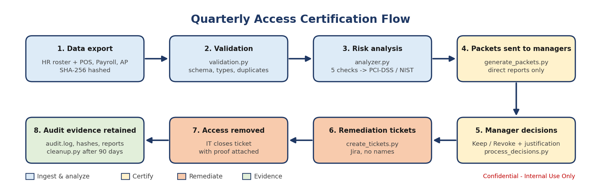
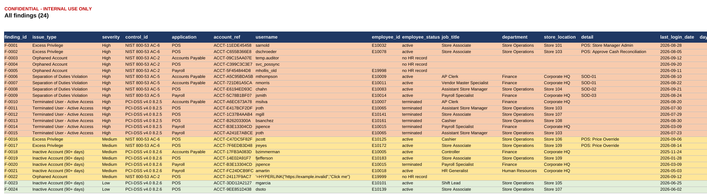
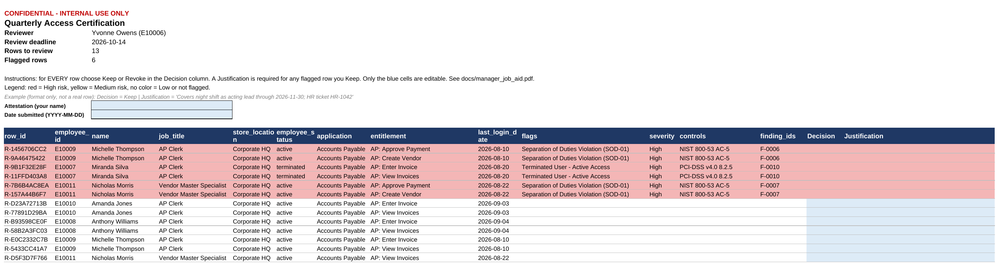
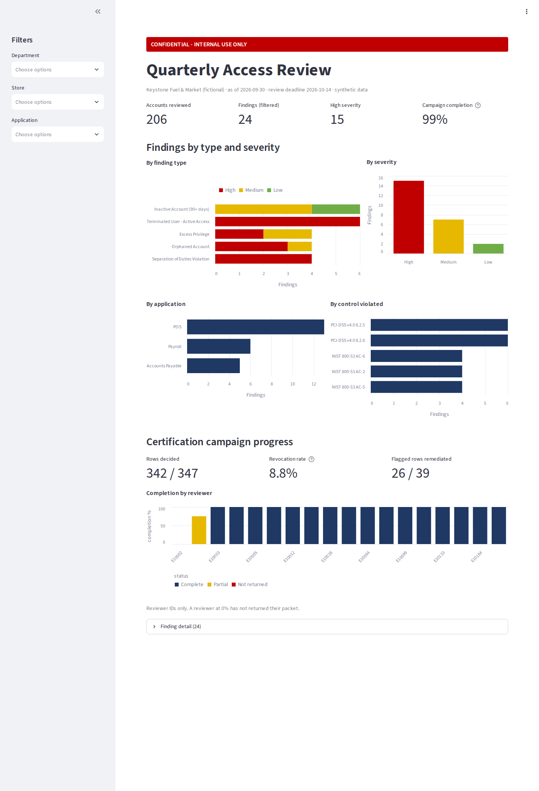
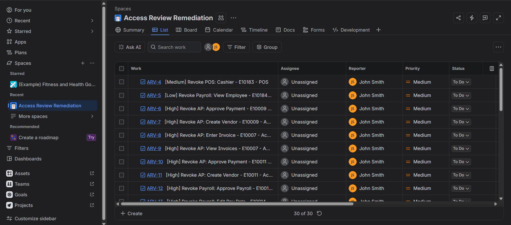

# Access Risk Analyzer & Certification Prep Tool

> **Confidential - Internal Use Only** (portfolio project; all data is synthetic)

Built with AI pair-programming assistance (Claude). I ran, tested, and extended every component: I stress-tested the detection rules by changing the review date, adding SoD rules, and simulating terminated managers, and I measured the effect on precision and recall. I also added input validation that rejects impossible future-dated login records and a Windows script for running the full pipeline.

A Python toolkit that prepares a quarterly user access review. It reconciles HR data against three applications, finds risky access, maps every finding to a PCI-DSS or NIST 800-53 control, builds per-manager certification packets, processes managers' decisions, and opens Jira remediation tickets. The whole pipeline is built around secure data-handling controls.



## Scenario

I'm an IAM Governance Analyst at **Keystone Fuel & Market**, a fictional 24/7 convenience and fuel retailer with 10 stores and a corporate office. Before the quarterly access review, my manager hands me exports from HR and three applications: **POS**, **Payroll**, and **Accounts Payable**. My job is to find risky access, tie each finding to the control it violates, and get certification packets in front of the right managers.

Convenience retail has specific fraud patterns, and the separation-of-duties rules reflect them. A cashier who can both **issue refunds** and **approve the cash reconciliation** can refund fake returns and approve the drawer count that would expose them. An AP clerk who can **create vendors** and **approve payments** can pay a vendor that doesn't exist.

## Findings summary

Run date: as of **2026-09-30** (fixed in `config.py` so results are reproducible).

| | |
|---|---|
| Identities in HR roster | 200 (18 terminated) |
| Application accounts reviewed | **206** (347 entitlement rows) |
| Findings | **24**: 15 High, 7 Medium, 2 Low |
| Detection accuracy vs. answer key | **24/24 recall, 24/24 precision** (see note) |

| Finding type | Control | High | Medium | Low | Total |
|---|---|---:|---:|---:|---:|
| Terminated user with active access | PCI-DSS v4.0 8.2.5 | 6 | 0 | 0 | 6 |
| Inactive account (90+ days) | PCI-DSS v4.0 8.2.6 | 0 | 4 | 2 | 6 |
| Excess privilege | NIST 800-53 AC-6 | 2 | 2 | 0 | 4 |
| Separation of duties violation | NIST 800-53 AC-5 | 4 | 0 | 0 | 4 |
| Orphaned account | NIST 800-53 AC-2 | 3 | 1 | 0 | 4 |

### Top 3 risks and recommended remediation

Risks are ranked by severity-weighted count (High = 3, Medium = 2, Low = 1).

1. **Terminated users with active access (6 accounts, all High).** One account shows a login *after* the termination date, which suggests a shared or stolen credential. **Remediation:** disable all six today and review activity on the post-termination login. Longer term, have HR terminations trigger account disablement automatically (an HR-to-IAM feed) instead of relying on a manual ticket.
2. **Separation of duties violations (4 people, all High).** Two AP users can create *and* pay vendors, one assistant store manager can refund *and* approve cash counts, and one payroll specialist can change pay rates *and* approve payroll. **Remediation:** remove one entitlement from each pair. Where staffing makes that impossible (small stores), require a documented compensating control, such as district-manager co-sign on cash reconciliations. Add SoD checks to the access-request workflow so new conflicts are blocked before they're granted.
3. **Orphaned accounts (4, three High).** These include a service account holding POS Store Manager Admin, an ended contractor who can still approve AP payments, and a payroll account tied to an employee ID that doesn't exist. **Remediation:** disable them now. Require every service account to have a named human owner recorded in HR or a CMDB, and reconcile contractor accounts against contract end dates.

### A note on the 100% detection accuracy

The answer key was planted by the same author who wrote the detector, so 100% shows the rules work as designed. It is **not** a claim about real-world accuracy. Its real value is as a **regression test**: if a code change breaks a detection, accuracy drops and the report shows exactly which item was missed.

To make the test meaningful, the data includes traps:
- **A decoy account at exactly 90 days**, which must *not* be flagged (the rule is "over 90").
- **An account that is both terminated and dormant**, which must be counted under both types.
- **A store manager who left properly** but whose team still reports to them in HR, which must not break packet routing.

### Certification campaign (simulated)

`simulate_decisions.py` fills in packets the way real managers behave, both good and bad, so `process_decisions.py` can be demonstrated:

| Metric | Result |
|---|---|
| Packets issued / returned | 18 / 17 |
| Completion rate (rows decided ÷ rows issued) | 342 / 347 = **98.6%** |
| Revocation rate (revoked ÷ decided) | 30 / 342 = **8.8%** |
| Flagged rows revoked | 26 / 39 |
| Overdue or late reviewers | 3 (not returned, incomplete, late) |
| Rubber-stamping detected | 1 reviewer (kept 100% including 6 flagged rows) |
| Flagged Keeps missing justification | 7 rows |

## Security measures

| # | Requirement | How it's implemented |
|---|---|---|
| 1 | Synthetic data only | Faker **and** Python's `random`, both seeded (`SEED` in `config.py`). The as-of date is fixed too, so regenerating gives **byte-identical** files. |
| 2 | No secrets in code | Jira credentials load from `.env` via python-dotenv; only `.env.example` (placeholders) is committed. The token is never printed or logged. |
| 3 | `.gitignore` | Excludes `.env`, `/output/`, `/packets/`, `/logs/`, `*.xlsx`, `*.log`, `__pycache__/`, and venv folders. Verified with `git status`. |
| 4 | Least-privilege integration | Designed for a dedicated free Jira account scoped to one project. The script needs only *Browse* and *Create issues*. |
| 5 | Input validation | `validation.py` checks exact columns, ID formats, allowed values, date formats, duplicate keys, manager references, entitlement/application consistency, and impossible future-dated logins. It reports **every** error with CSV line numbers and stops with exit code 2.
| 6 | Formula-injection protection | Every string cell starting with `=`, `+`, `-`, `@`, tab, or CR gets a leading apostrophe before any CSV/Excel write. Numbers and dates are left alone. Tested with a planted `=HYPERLINK(...)` username. |
| 7 | Safe logging | `logs/audit.log` records `timestamp \| action \| record_count \| sha256` using IDs only. A scan confirmed zero names or usernames appear in the log. |
| 8 | Integrity check | SHA-256 of each input is recorded at the start of each run and included in the report's *Input Integrity* sheet. |
| 9 | Separate packets per manager | Each packet contains only the reviewer's direct reports, and the script **aborts** if any row would violate that. Teams of terminated managers escalate up the chain to the nearest active manager (tested two levels deep). Orphans go to an IAM-only packet. |
| 10 | Confidentiality marking | Every output carries the marking: Excel (in-sheet banner and print header), CSV (first line), PDF job aid, dashboard, and Jira tickets. |
| 11 | Local-only dashboard | `.streamlit/config.toml` binds to `127.0.0.1`. The app **refuses to render** on any other bind address, and the Deploy button is hidden. |
| 12 | Dependency security | Versions pinned in `requirements.txt`; pip-audit and bandit results are [below](#security-scan-results). |
| 13 | Data retention | `cleanup.py` deletes generated reports and packets after **90 days** (see [Retention](#data-retention)). |

**Beyond the requirements:**
- **Usernames stay out of tickets, logs, and the dashboard.** Usernames like `jsmith` contain names, so those places use a hashed `ACCT-xxxxxxxxxx` reference instead.
- **Packets are tamper-checked.** Each issued packet's row IDs go into `packets/manifest.json`. A returned packet with rows added or deleted, or a changed reviewer, is rejected.
- **Packets are protected.** Sheets are locked except the Decision, Justification, and sign-off cells. This is an integrity aid, not a security boundary.
- **Jira calls are hardened.** HTTPS is required, there's a request timeout, and `Retry-After` is honored on rate limits.
- **Ticketing is idempotent.** Each ticket carries a campaign-scoped label, so rerunning `create_tickets.py --live` creates zero duplicates. Verified against live Jira Cloud: 30 tickets created, and a rerun created 0 duplicates.

## Setup

Requires Python 3.11+ (tested on 3.12 and 3.14, Linux and Windows).

**Windows (PowerShell):**
```powershell
git clone https://github.com/Connor-Metzger/access-risk-analyzer.git
cd access-risk-analyzer
python -m venv .venv
.venv\Scripts\Activate.ps1
pip install -r requirements.txt
copy .env.example .env             # only needed for live Jira tickets
```

**Mac/Linux:**
```bash
git clone https://github.com/Connor-Metzger/access-risk-analyzer.git
cd access-risk-analyzer
python -m venv .venv
source .venv/bin/activate
pip install -r requirements.txt
cp .env.example .env               # only needed for live Jira tickets
```

## How to run

Run the whole demo with `.\run_demo.ps1` (Windows) or `./run_demo.sh` (Mac/Linux), or run each step:

| Step | Command | Output |
|---|---|---|
| 1. Generate data | `python src/generate_data.py` | `data/*.csv` including the `planted_issues.csv` answer key |
| 2. Analyze | `python src/analyzer.py` | `output/findings_report.xlsx`, `output/findings.csv` |
| 3. Build packets | `python src/generate_packets.py` | `packets/packet_<reviewer>.xlsx`, `packets/manifest.json` |
| 3b. Simulate reviews (demo only) | `python src/simulate_decisions.py` | `packets/completed/*.xlsx` |
| 4. Process decisions | `python src/process_decisions.py` | `output/campaign_summary.xlsx`, `output/revocations.csv` |
| 5. Jira tickets | `python src/create_tickets.py` (dry run), then add `--live` | Jira issues, `output/ticket_ledger.csv` |
| Dashboard | `streamlit run src/dashboard.py` | http://127.0.0.1:8501 |
| Retention | `python src/cleanup.py --dry-run`, then without `--dry-run` | Deletes expired outputs |
| Docs | `python src/make_job_aid.py`, `python src/make_flow_diagram.py` | `docs/` |

**Options and real-world use:**
- **Testing validation:** point the analyzer at other files with `--hr`, `--accounts`, `--sod`. Try deleting a column or duplicating an ID to see the error report.
- **Real decisions:** instead of simulating, copy managers' returned packets into `packets/completed/` and run step 4.
- **Evaluation date:** `--review-date` sets the date the campaign is judged against. The default is the day after the deadline.

### Jira setup (for `--live`)

1. Create a free Jira Cloud site with a **dedicated account** used only by this project.
2. Create a project (key `ARV`) and give that account access to only this project.
3. Create an API token at id.atlassian.com, then put the site URL, email, token, and project key in `.env`.
4. Run `python src/create_tickets.py --live`. Run it again to confirm it skips existing tickets.

Each ticket contains employee ID, application, entitlement, control reference, severity, finding ID, and approving reviewer ID. It never contains a name or username.

## Screenshots

**Findings report.** Severity color-coding and control mapping. Note the escaped `'=HYPERLINK(...)` username in row F-0022: the injection payload is stored as inert text.


**Manager certification packet.** Only this manager's direct reports, with flagged rows highlighted, a Keep/Revoke dropdown, and editable cells in blue.


**Dashboard.** Findings by type, severity, application, and control, plus campaign progress. Runs on localhost only.


30 remediation tickets created by `create_tickets.py --live`, one per Revoke decision, with employee IDs only. A second run created 0 duplicates (idempotency check).



## Security scan results

**bandit** (`bandit -r src`): **0 issues** across 2,077 lines. The first scan found 4 Low-severity items, triaged as follows:

| Finding | Location | Disposition |
|---|---|---|
| B101 `assert` used | `generate_data.py` | **Fixed.** Replaced with an explicit `RuntimeError`, since asserts are stripped under `python -O`. |
| B311 non-crypto `random` | `generate_data.py`, `simulate_decisions.py` | **Accepted, `# nosec B311`.** A seeded PRNG is intentional for reproducible synthetic data. Nothing security-relevant uses it. |
| B406 `xml.sax` import | `make_flow_diagram.py` | **Accepted, `# nosec B406`.** Only `escape()` is used, to *write* XML. No XML is parsed, so XXE doesn't apply. |

**pip-audit** (`pip-audit -r requirements.txt`): **No known vulnerabilities found** in the resolved dependency tree (scanned 2026-10-11). Rerun it before each campaign; a clean result is only valid on the day it's run.

## Data retention

| Data | Location | Retention | Mechanism |
|---|---|---|---|
| Findings reports, campaign summaries, CSV extracts | `output/` | **90 days** after creation | `python src/cleanup.py` (deletes files older than 90 days) |
| Manager packets (blank and completed) | `packets/` | **90 days** | same |
| Audit log | `logs/audit.log` | **1 year** (audit evidence) | Manual archival; deliberately not touched by `cleanup.py` |
| Synthetic source data | `data/` | Kept (fake, reproducible) | n/a |

`cleanup.py` logs the SHA-256 of each file before deleting it, so there's evidence of what existed and when it was destroyed. Use `--all` at the end of a campaign once evidence has been handed to audit. In a real deployment, schedule the script (cron or Task Scheduler) and align the periods with your organization's records-retention policy.

## Design decisions and assumptions

- **Fixed as-of date.** Dormancy is measured against `AS_OF_DATE`, not `today()`, so rerunning next month gives the same results.
- **The account export lists enabled accounts only.** The spec's columns have no account-status field, so an account's presence in `app_accounts.csv` means it's active.
- **SoD is evaluated per person across all applications.** A rule spanning two apps would still be caught, even though the current four rules are each within one app.
- **Excess privilege** means a frontline title (Store Associate, Cashier) holding an entitlement on the manager-level list in `config.py`.
- **Severity rules:**
  - *Terminated* and *SoD* findings are always High.
  - *Orphans* are High when they're in a financial app or hold privileged access.
  - *Dormant* accounts are Medium when they're in a financial app, privileged, or over 180 days inactive; otherwise Low.
- **Formula escaping** uses the literal leading apostrophe the requirement specifies. In Excel that apostrophe is visible in the cell. That's an acceptable trade-off for clearly showing the value was neutralized.
- **Test payload in the data.** `data/app_accounts.csv` deliberately contains a formula-injection payload pointing to the reserved `example.invalid` domain. It's harmless, but don't open the raw input CSV in Excel; open the sanitized outputs instead.

## Repository structure

```
access-risk-analyzer/
  data/                synthetic CSVs + planted_issues.csv answer key
  src/
    config.py          seed, dates, entitlements, control mapping
    common.py          hashing, audit log, formula-injection escaping
    validation.py      input validation (requirement 5)
    generate_data.py   step 1
    analyzer.py        step 2
    generate_packets.py, simulate_decisions.py, process_decisions.py   step 3
    create_tickets.py  Jira (extra B)
    dashboard.py       Streamlit (extra A)
    cleanup.py         retention (requirement 13)
    make_job_aid.py, make_flow_diagram.py   docs
  docs/                manager_job_aid.pdf, certification_flow.{png,drawio}, screenshots/
  output/ packets/ logs/   generated, gitignored
  .streamlit/config.toml   localhost binding
  .env.example  .gitignore  requirements.txt  requirements-dev.txt  run_demo.sh  run_demo.ps1
```

Manager job aid: [docs/manager_job_aid.pdf](docs/manager_job_aid.pdf), a one-page guide titled "How to Complete Your Access Review."
